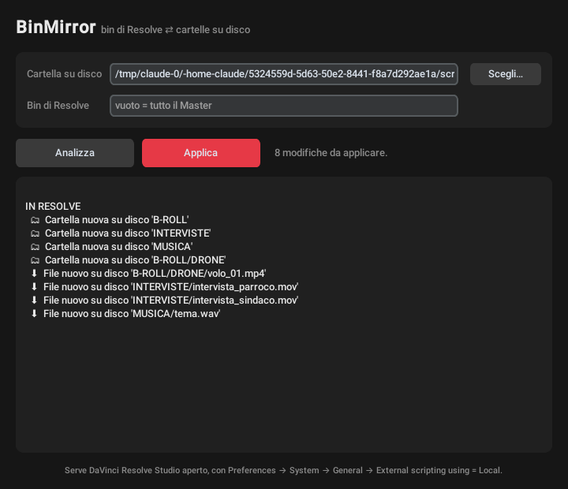

# BinMirror

I bin di **DaVinci Resolve** e le cartelle su disco (anche su un disco esterno) sempre uguali, come in
Avid Media Composer. Sposti una clip da un bin all'altro e il file si sposta nella cartella giusta;
rinomini una cartella nel Finder e il bin si rinomina in Resolve.

Stato: **0.2.0, app con interfaccia + installer DMG**. Il motore è verificato sulla Resolve Studio
vera (vedi sotto). L'app e il DMG sono costruiti come DropCut, ⚠️ ancora da provare sul Mac.

## Cosa fa

| Cosa fai | Dove | Cosa succede dall'altra parte |
|---|---|---|
| Crei un bin | Resolve | nasce la cartella |
| Crei una cartella | disco | nasce il bin |
| Sposti o rinomini un bin | Resolve | stessa cosa alla cartella, le clip vengono ricollegate |
| Sposti o rinomini una cartella | disco | stessa cosa al bin, le clip vengono ricollegate |
| Sposti una clip in un altro bin | Resolve | il file va nella cartella di quel bin (+ relink) |
| Sposti un file in un'altra cartella | disco | la clip va nel bin di quella cartella (+ relink) |
| Metti un file nuovo in una cartella | disco | viene importato nel bin giusto |
| Togli una clip | Resolve | il file va in `_CESTINO` |
| Togli un bin | Resolve | la cartella va in `_CESTINO` |
| Cancelli una cartella vuota | disco | il bin si toglie, solo se è vuoto |

Regole di sicurezza:
- **Nessun file viene mai cancellato.** Quello che sparisce va in `<radice>/_CESTINO/<data_ora>/…`.
- Prima sincronizzazione: si unisce e basta, niente cestino. Se una clip sta in un bin diverso dalla
  cartella del suo file, comanda il disco (si sposta la clip, non il file).
- Se la radice non c'è (disco scollegato) o è vuota quando prima non lo era: **si blocca**.
- Se dovrebbe mettere nel cestino troppi file insieme (progetto sbagliato aperto?): si blocca,
  serve `--forza`.
- Clip con il file fuori dalla cartella radice: non vengono toccate.
- Un bin che contiene ancora qualcosa (anche solo timeline) non viene mai tolto.

## Come funziona

Tre foto a confronto: il disco, il Media Pool e lo **stato** dell'ultima sincronizzazione
(`<radice>/.binmirror/state.json`). Senza lo stato non si potrebbe capire chi ha cambiato cosa.

- File e cartelle sono riconosciuti dal loro id sul disco (inode), così uno spostamento non sembra
  "cancellato + nuovo". Sui dischi **exFAT** l'id cambia con lo spostamento: allora si riconoscono
  da dimensione + data di modifica (e, per le cartelle, dal contenuto).
- I bin sono riconosciuti da `Folder.GetUniqueId()`. Se la tua versione di Resolve non lo ha,
  BinMirror non mette mai nel cestino una cartella per un bin sparito (non può distinguerlo da una
  rinomina).
- Resolve **non avvisa** gli script quando cambi qualcosa nel Media Pool: per questo si sincronizza
  su comando (poi arriverà la modalità automatica, che rifà il confronto ogni pochi secondi).
- La parte Resolve gira in un processo separato (`binmirror/resolve_helper.py`), come in DropCut.

## Requisiti

- **DaVinci Resolve Studio** (lo scripting da fuori Resolve nella versione free non è disponibile).
- In Resolve: *Preferences → System → General → External scripting using = Local*, poi riavvia.
- Python 3.8+ (sul Mac va bene quello dei Command Line Tools). Nessuna libreria esterna.

## L'app



1. In Resolve: *Workspace → Scripts → BinMirror* (oppure apri `/Applications/BinMirror.app`).
2. Scegli la **cartella su disco**. Se vuoi rispecchiare solo un bin, scrivi il suo nome
   (es. `MATERIALI`); vuoto = tutto il Master.
3. **Analizza** mostra cosa cambierebbe su disco e in Resolve. Non tocca niente.
4. **Applica** esegue. Ricorda cartella e bin per la volta dopo (`~/.binmirror_config.json`).

Log: `~/Library/Logs/BinMirror.log`.

## Costruire il DMG (sul Mac)

Serve un Python con Tcl/Tk 8.6 (python.org 3.12) e i Command Line Tools. Il DMG finisce sul Desktop:

```bash
cd "$HOME" && { [ -d "$HOME/binmirror/.git" ] || git clone https://github.com/andrearicciotti1/binmirror.git "$HOME/binmirror"; } && cd "$HOME/binmirror" && git pull && ./macos/build_dmg.sh
```

Il .pkg installa `/Applications/BinMirror.app` e il launcher in *Workspace → Scripts*. L'app include
un Python portatile per parlare con Resolve anche sui Mac senza Command Line Tools. Non è firmata:
sul Mac dove la installi si apre lo stesso (il postinstall toglie la quarantena).

## Riga di comando (prova veloce, progetto di prova!)

Crea in Resolve un **progetto nuovo e vuoto**, aprilo, poi nel Terminale:

```bash
cd "$HOME" && { [ -d "$HOME/binmirror/.git" ] || git clone https://github.com/andrearicciotti1/binmirror.git "$HOME/binmirror"; } && cd "$HOME/binmirror" && git pull && mkdir -p "$HOME/Desktop/BINMIRROR_TEST/INTERVISTE" "$HOME/Desktop/BINMIRROR_TEST/MUSICA" && python3 -m binmirror analizza "$HOME/Desktop/BINMIRROR_TEST"
```

Copia qualche file video/audio dentro `~/Desktop/BINMIRROR_TEST/INTERVISTE` e `MUSICA`, poi:

```bash
cd "$HOME/binmirror" && python3 -m binmirror applica "$HOME/Desktop/BINMIRROR_TEST"
```

Mostra l'anteprima e chiede conferma. Opzioni: `--bin NOME` rispecchia solo quel bin invece di
tutto il Master; `--si` applica senza chiedere; `--forza` supera il blocco sul cestino.

## Verifica sulla Resolve vera

✅ 14/10/2026, DaVinci Resolve Studio 21.1.1 su macOS, progetto vuoto + `~/Desktop/BINMIRROR_TEST`,
con `/usr/bin/python3` (3.9) dei Command Line Tools: import nei bin, clip spostata tra bin,
file spostato su disco, cartella rinominata su disco, bin spostato dentro un altro bin, clip e bin
tolti da Resolve (finiti in `_CESTINO`). Dopo ogni `applica` le clip restano Online e `analizza`
dice "allineati". Funzionano `Folder.GetUniqueId`, `MoveFolders`, `MoveClips`, `DeleteFolders`,
`RelinkClips`, `GetClipProperty("File Path")`.

Nota: `Folder` non ha `SetName` nelle API, quindi una cartella rinominata su disco diventa in Resolve
un bin nuovo in cui si spostano le clip (il vecchio, vuoto, si toglie).

⚠️ Non ancora provato: rinominare un bin a mano dall'interfaccia di Resolve (le API non lo
permettono, va fatto a mano) e i dischi exFAT.

## Test

```bash
python3 -m unittest discover -s tests -v
```

`tests/fake_fusionscript.py` simula Resolve; `tests/test_mirror.py` contiene gli scenari.
